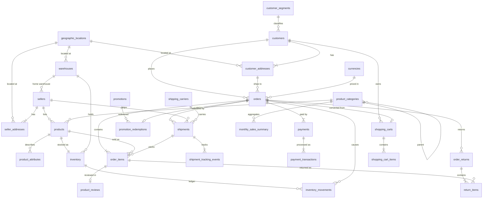

# Data model

30 business tables in four layers, plus 3 application metadata tables. All tables are InnoDB, `utf8mb4`.
DDL lives in [`sql/schema/`](../sql/schema) and is applied in file order.

## Entity-relationship diagram

Dependent entities (order lines, payments, shipments, tracking events, returns) use composite natural keys
such as `(order_id, item_seq)`. This keeps keys deterministic: the generator produces identical keys on every
run, in any worker order, and on resume. `inventory_movements` is the only fact table with an
`AUTO_INCREMENT` surrogate key.

## Tables

### Reference
| Table | Purpose |
|---|---|
| `currencies` | ISO currency codes and reference rates to BRL. All orders are priced in BRL. |
| `geographic_locations` | Brazilian postal-code prefixes (CEP) with city, state, region and coordinates. Prefixes lie inside each state's real CEP range. |
| `customer_segments` | Marketing segments (new, occasional, regular, loyal, VIP). |
| `shipping_carriers` | Fictional carriers with service level, rates and median transit time. |
| `warehouses` | Fulfilment centres; each seller ships from the nearest one. |
| `product_categories` | Two-level tree: top-level groups and leaf categories modelled on the Olist categories. |

### Master data
| Table | Purpose |
|---|---|
| `customers` | Fictional customers with reserved `example.com` e-mail and invalid area code `00` phone numbers. |
| `customer_addresses` | One to three addresses per customer; zip code prefix matches its location. |
| `sellers` | Marketplace sellers with rating, home warehouse and a handling-speed profile. |
| `seller_addresses` | Registered and pickup addresses. |
| `products` | Catalogue with list and cost price, weight and dimensions; each product belongs to one seller and one leaf category. |
| `product_attributes` | Key/value attributes (colour, material, voltage…) by category type. |
| `promotions` | Percent or fixed discounts with validity windows, including Black Friday campaigns. |
| `inventory` | Stock position per product and warehouse. `quantity_on_hand` equals the sum of its movements. |

### Transactions
| Table | Purpose |
|---|---|
| `orders` | Order header with lifecycle timestamps and totals. CHECK: `total = subtotal + shipping - discount`. |
| `order_items` | Order lines. Prices reflect list price with time drift and occasional seller discounts. |
| `shipments` | One shipment per seller in an order, from the seller's warehouse with a chosen carrier. |
| `shipment_tracking_events` | Chronological tracking events, including failed delivery attempts. |
| `payments` | Payment instruments per order (card with installments, boleto, Pix, voucher, debit). Their sum equals the order total. |
| `payment_transactions` | Authorization, capture, refund and void events per payment, including declines. |
| `order_returns` / `return_items` | Returns of delivered orders; returned quantity never exceeds purchased quantity. |
| `product_reviews` | One optional review per delivered order line; ratings drop for late deliveries and returns. |
| `promotion_redemptions` | Promotion applied to an order within its validity window. |
| `shopping_carts` / `shopping_cart_items` | Active, abandoned and converted carts; converted carts mirror their order. |
| `inventory_movements` | Stock ledger: opening stock, receipts, sales, customer returns, adjustments, damage. |

### Analytics and audit
| Table | Purpose |
|---|---|
| `daily_sales_summary` | Orders, units and revenue per purchase date (canceled and unavailable orders excluded from revenue). |
| `monthly_sales_summary` | Item revenue per month and leaf category. |
| `data_generation_audit` | Rows inserted per table per generation job. Kept across cleanup. |

### Application metadata (not part of the 30)
| Table | Purpose |
|---|---|
| `lab_schema_info` | Ownership marker and schema version. Cleanup refuses to run without it. |
| `lab_jobs` | Every job: type, status, configuration snapshot, progress, result, error log, timestamps. |
| `lab_job_batches` | Commit ledger. A unit is marked done in the same transaction as its rows, which makes resume exactly-once. |

### Import staging (schema version 2, not part of the 30)
| Table | Purpose |
|---|---|
| `stg_olist_*` (9 tables) | One per Olist CSV file. Validated, typed rows keyed by `src_row` (data record number), indexed for the transform's joins. No foreign keys, so files can be loaded in any order. |
| `stg_import_rejects` | Sample (capped per unit) of rejected CSV records with the reason; complete counts are in the job statistics. |
| `map_olist_ids` | Olist 32-character hex ids (and product × seller listings, and categories) to lab `BIGINT` ids. Numbered with `ROW_NUMBER()` over a stable order, so the transform is deterministic. Emptied together with generated data. |

### Optional object tables (created on demand)
| Table | Purpose |
|---|---|
| `order_status_history` | Audit trail written by `trg_orders_status_history` when an order's status changes (database object catalog). |
| `exp_orders_partitioned` | Partitioning lab: a copy of `orders` partitioned by `purchased_at`, primary key `(order_id, purchased_at)`, no foreign keys. Never referenced by other tables. |

Both are emptied together with generated data when they exist.

### Performance Lab (schema version 4)
| Table | Purpose |
|---|---|
| `bench_events` | Scratch table for write benchmarks (inserts, updates, transactions). Benchmarks never write to the business tables; this table is truncated before and after every write run. |

## Indexing rationale

Indexes follow known query patterns rather than covering every column:

- `orders (customer_id, purchased_at)`: customer order history and repeat-purchase analysis.
- `orders (purchased_at)` and `orders (status, purchased_at)`: date-range dashboards and status filters; used by the summary refresh.
- `shipments (carrier_id, shipped_at)`: carrier performance over time.
- `inventory_movements (product_id, warehouse_id, moved_at)`: stock ledger per position; also backs the composite foreign key.
- `promotion_redemptions (promotion_id, redeemed_at)`: campaign performance.
- Every foreign key has a supporting index (InnoDB requires one).

Optional, query-driven indexes from the object catalog (`sql/objects/indexes/`) each name the query they serve and
can be checked with EXPLAIN before and after applying them.

## Partitioning

MariaDB requires every unique key, including the primary key, of a partitioned table to contain the partitioning
column, and InnoDB does not support foreign keys on partitioned tables at all. Partitioning `orders` by
`purchased_at` would therefore require dropping its foreign keys and widening its primary key. The Partitioning lab
therefore works on a separate copy (`exp_orders_partitioned`), never on the transactional schema.
